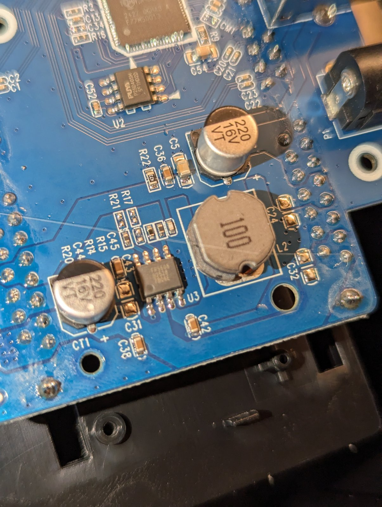

# Flashing: back up, build, write, check, roll back

This is the procedure that put the UASP + TRIM firmware on our Ugreen CM198. It uses an SPI programmer on the flash chip, because the image has to go into copy 0 and the USB update path can't write there ([why](#why-not-over-usb)).

Read [lessons.md](lessons.md) first. Every rule below is there because breaking it cost us a brick or a wasted day.

## What you need

- A CH347T USB programmer (`1a86:55db`) and a SOIC-8 test clip. Any SPI programmer flashrom supports will do. We used the CH347T at its default 3.3 V.
- flashrom with the `ch347_spi` programmer and the PUYA `P25D40SH` chip entry. Our distribution's package didn't know the chip, so [`tools/setup-flashrom`](../tools/setup-flashrom) builds the upstream revision that wrote every image of this project. Then `export FLASHROM=~/.local/opt/flashrom-main/sbin/flashrom`.
- A Linux machine, Python 3, `bsdtar` or `7z` to unpack Ugreen's archive, `sg3_utils` for the checks.
- A SATA disk you can put in a bay for the first boot. The bridge doesn't enumerate on USB without a disk.
- A Phillips screwdriver to open the enclosure.

## 1. Open the enclosure and find the flash

1. Unmount every disk of the enclosure, then unplug USB and the 12 V supply.
2. Take the disks out and open the case. The board is Ugreen `KB-SA0015-A2`.
3. The bridge is U1, marked `JMS561U`. The SPI flash is U2 just below it, an 8-pin SOIC marked PUYA `P25D40SH` (512 KiB, JEDEC ID `85 60 13`). Photos: [hardware.md](hardware.md).
4. Find pin 1 on U2 (the dot or bevel) and seat the clip with its pin 1 wire on it.



Keep the enclosure's 12 V supply unplugged the whole time the clip is on. The CH347T powers the flash.

## 2. Read the original flash, twice

```sh
tools/jms561-clip read original
```

The script reads the chip twice in 32 separate 16 KiB flashrom sessions and refuses to continue if the two reads differ. On our board, whole-chip sessions through the clip kept dropping to `FF` part-way through (six reads, six different hashes), while 16 KiB sessions were stable. The result lands in `backups/clip-<time>-original/image.bin`, read-only. It contains your enclosure's serial number, so don't publish it.

Copy the backup somewhere else as well. It's the only thing that can give you back your enclosure's parameter pages.

Our stock CM198 read `1a7df071…86af`. Yours will differ in the parameter pages, and the builder tells you which firmware the code part is.

## 3. Build your image

```sh
tools/fetch-ugreen-2018
tools/jms561u_build.py --backup backups/clip-*-original/image.bin --out trim.bin
```

`fetch-ugreen-2018` downloads Ugreen's package from its GitHub mirror, checks the archive's sha256 (`b41502a4…b4b0f2`) and extracts `CM198-v167.001.000.004-20180730-meta.bin` (sha256 `57099a24…3e64e7`). The builder applies [`patches/trim.rows`](../patches/trim.rows) to copy 0, recomputes every CRC, takes the parameter pages from your backup and checks that the code part matches the published hash `6855b9b5…04d440c`. It prints the sha256 of your full image; you'll need it in the next step.

```
backup  1a7df071…  firmware 167.2.0.21: Ugreen stock 167.2.0.21 (2020, no UASP)
code    6855b9b5…  this project's UASP + TRIM image (matches the published hash)
OK      86be624c…  trim.bin
```

Add `--uas-only` for Ugreen's 2018 code without the TRIM patch.

## 4. Write and verify

```sh
tools/jms561-clip write trim.bin <sha256 printed by the builder>
```

It reads the chip twice first (a second backup, in case you skipped step 2), writes the image in 16 KiB pieces, reads it back twice and compares the result with the sha256 you gave. `VERIFIED <sha256>` means the chip holds exactly your image. If a piece fails three times the script stops and says so. Run the same command again: the chip is partly written, and nothing has been powered on yet.

## 5. Boot it the right way

Order matters. The bridge loads firmware only on a cold 12 V power-up, and it doesn't appear on USB without a disk.

1. Take the clip off.
2. Put a SATA disk in a bay.
3. Plug in the 12 V supply and switch the enclosure on.
4. Plug USB straight into a USB 3 port of the computer, not into a shared USB 2 hub. (Our first "dead" test image turned out to be fine: it was on a USB 2 hub shared with the programmer.)

Then check:

```sh
lsusb -t                       # Driver=uas, 5000M
cat /sys/bus/usb/devices/*/product | grep JMS56   # "JMS56T Series" = the TRIM image runs
sudo tools/jms561-status
lsblk -D                       # DISC-MAX 32M on SSDs
```

"JMS56T Series" proves the patched copy runs. "JMS56x Series" means the bridge ran Ugreen's unpatched copy 1 instead, which should not happen with a correctly built image ([firmware-layout.md](firmware-layout.md), "Boot"). Then run the full test in [testing.md](testing.md) before you trust the enclosure with data.

## Roll back

Any image you read can go back the same way:

```sh
tools/jms561-clip write backups/clip-<time>-original/image.bin <its sha256>
```

On our enclosure both rollbacks worked: the stock 2020 image and Ugreen's 2018 image. The clip also brought the enclosure back from a fully erased copy 0 and erased parameter pages ([recovery.md](recovery.md)).

## Why not over USB

Ugreen's updater (JMMassProd 1.16.15.7) and our reimplementation [`tools/jms561u-usb`](../tools/jms561u-usb) write a 128 KiB image over USB with vendor SCSI commands. The bridge stores it in **copy 1** (`0x20000`) and leaves copy 0 alone. With a valid copy 0 in flash the bridge boots copy 0, so a USB update into copy 1 changes nothing you can see. We did that four times before we understood it.

So the USB path can't install this image on a stock enclosure. It's also unforgiving: if the image in copy 1 fails at run time, there is no USB way back. And a USB chip erase is how we bricked ours. Flashing the TRIM image over USB would need a firmware that writes copy 0 itself, which nobody has built yet. Until then the programmer is the way, and the clip doubles as your rollback.

The vendor's own instructions disagree with each other on whether a disk must be in a bay during a USB update: Ugreen's page says no disk, the ELEOK guide for 167.2.0.21 says a disk is required. The bridge needs a disk to enumerate at all, so we always had one in.
