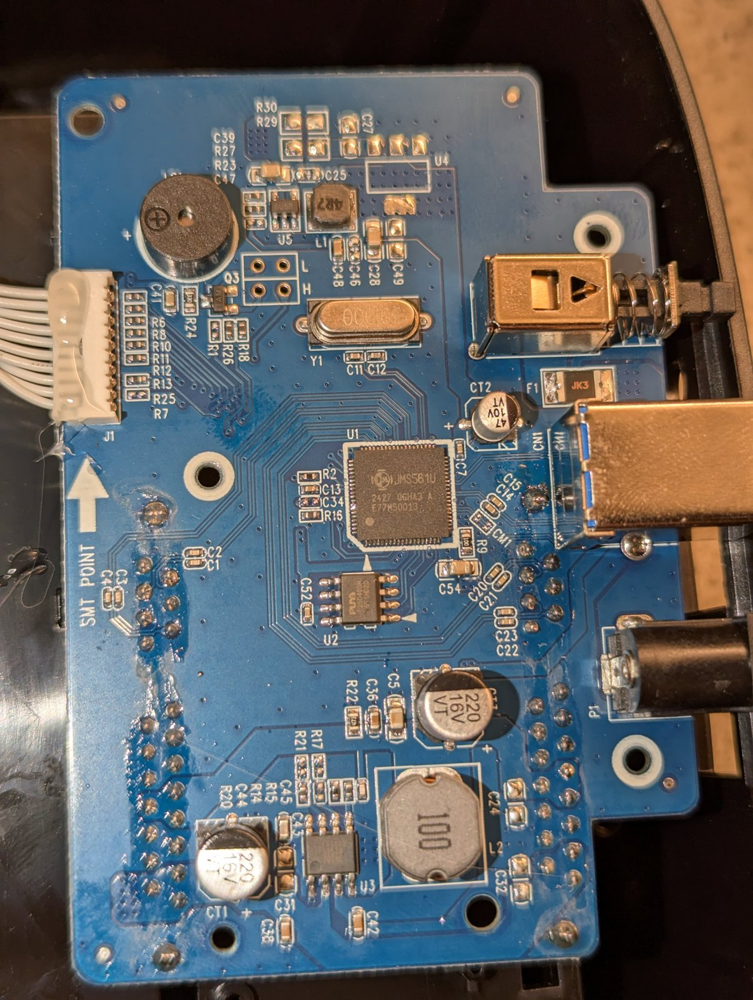
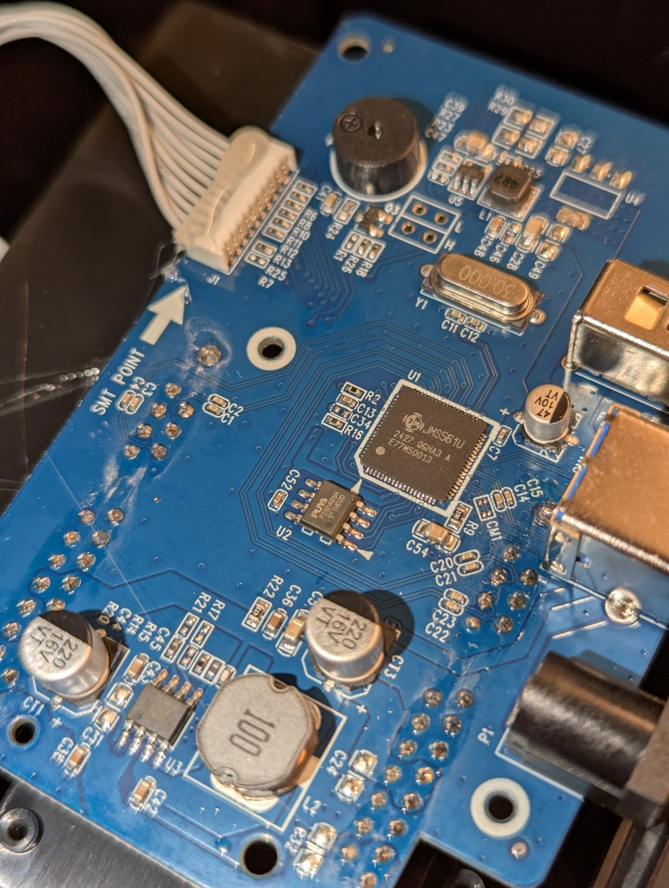
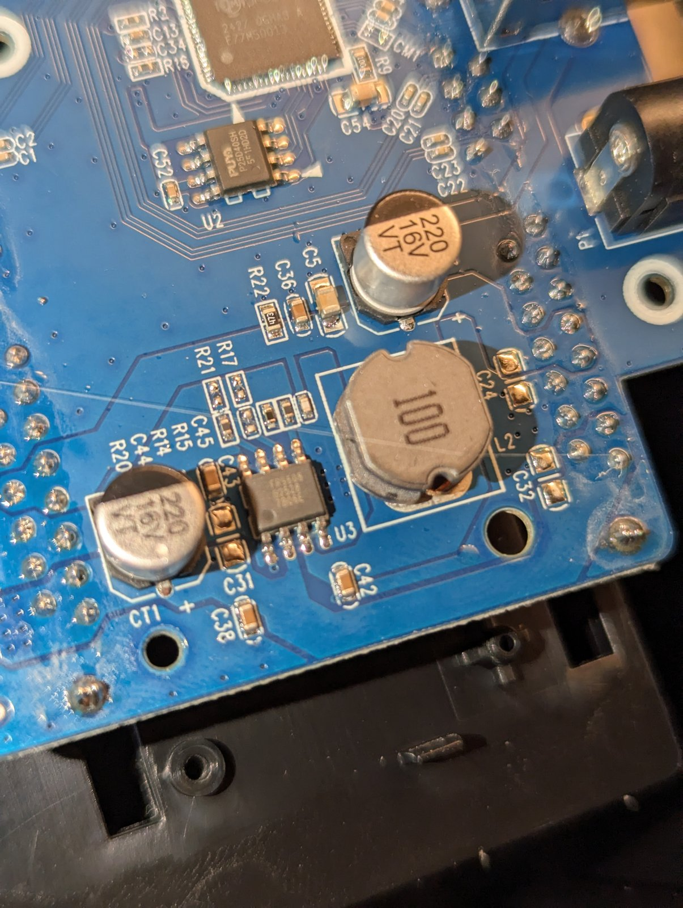
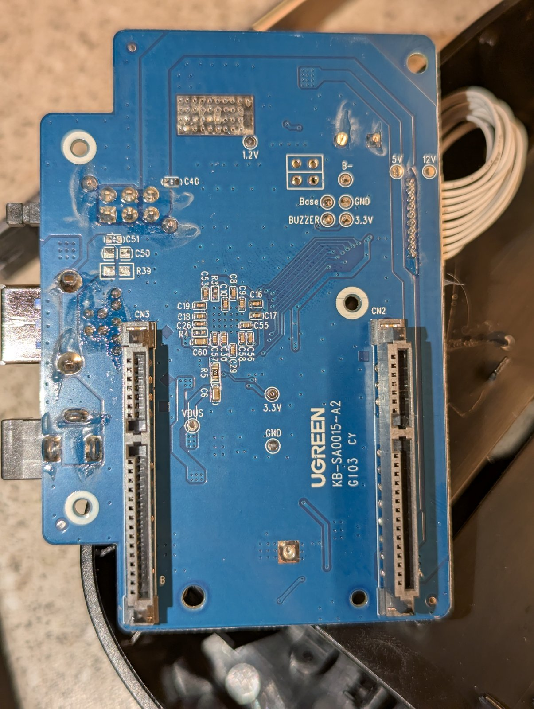

# Hardware: Ugreen CM198 with the JMicron JMS561U

The Ugreen CM198 is a two-bay 2.5"/3.5" SATA docking station and enclosure with USB 3.0 (5 Gb/s), an offline clone button and an external 12 V supply. Inside is one board.

| Part | What we found |
|---|---|
| Board | Ugreen `KB-SA0015-A2`, two SATA connectors on the underside |
| Bridge U1 | JMicron JMS561U, marking `JMS561U 2427 0GHA3 A E77MS0013`, 8051 core, USB 3.0 to two SATA 6 Gb/s ports |
| USB ID | `152d:1561` ("JMS561U two ports SATA 6Gb/s bridge" in usb.ids) |
| Chip info (vendor command `E0`) | family byte `[5] = 0x65` ('e'), `[6] = 3` in normal firmware, the last 4 bytes are the version |
| SPI flash U2 | PUYA P25D40SH (datasheet family P25Q40H), 512 KiB, JEDEC ID `85 60 13`, status register `0x00` (no write protection). Its SFDP table claims 16 MB, but addresses past 512 KiB wrap to zero |
| Firmware as shipped | 167.2.0.21 (2020), `bcdDevice 0.15`, Bulk-Only only |

JMicron's product brief lists the JMS561U as USB 3.0 to two SATA ports with UASP 1.0. 4PDA users report that the Acasis EC-7352 uses the same bridge as the CM198. More enclosures in [other-enclosures.md](other-enclosures.md).

## Things the hardware does that matter for flashing

- It enumerates on USB only with a SATA disk in a bay, with any firmware.
- It reloads firmware only when 12 V comes on.
- Through a SOIC-8 clip with the 12 V supply unplugged, the CH347T reads and writes U2 reliably in 16 KiB sessions. Whole-chip sessions dropped to `FF` part-way through.
- flashrom marks P25D40SH probe and read as tested and erase/write as untested. On this board erase and write worked for every image we wrote with it, each one verified by reading it back.

## Disks we used

- CUSU C200 960 GB SATA SSD, XFS. IDENTIFY word 169 = `0x0001` (TRIM supported), word 105 = `0x0008` (at most 8 blocks of ranges per DSM command).
- A 1 TB SATA SSD (model string "SSD"), btrfs, "Data Set Management TRIM supported (limit 8 blocks)".

No hard disk has been through the patched firmware yet.
